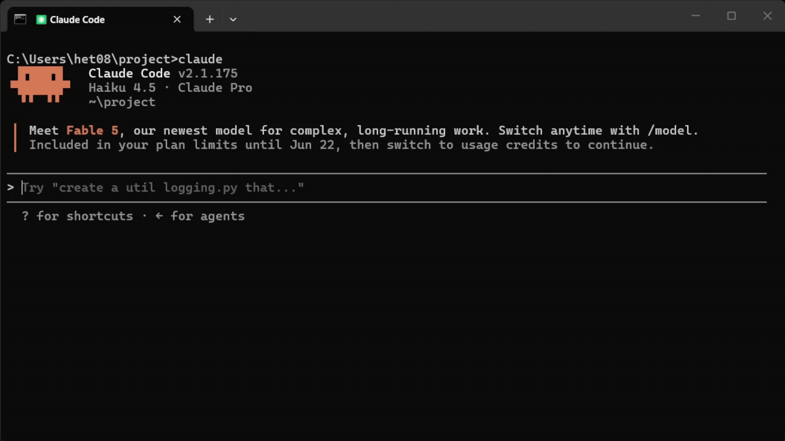
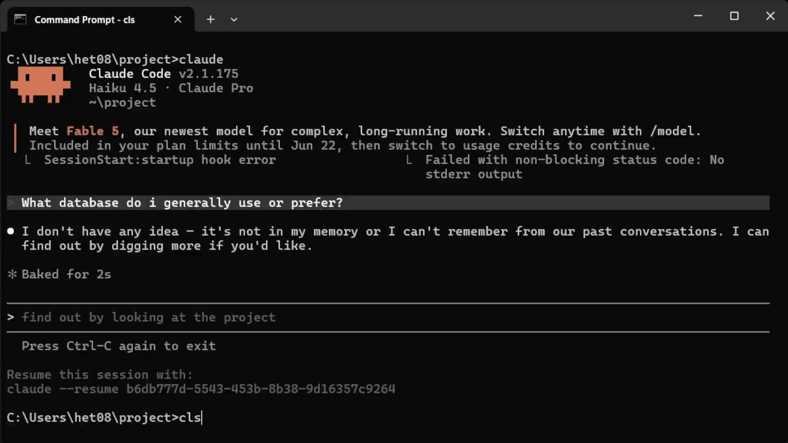
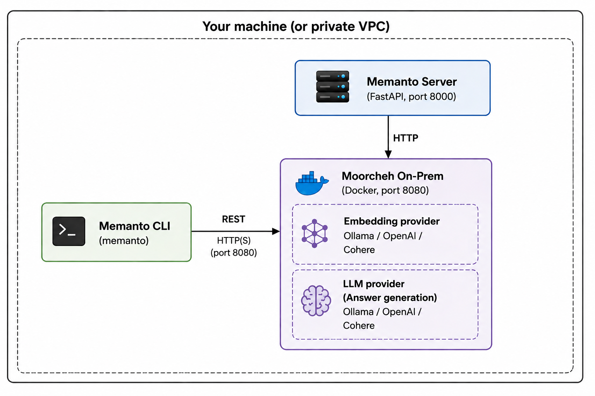
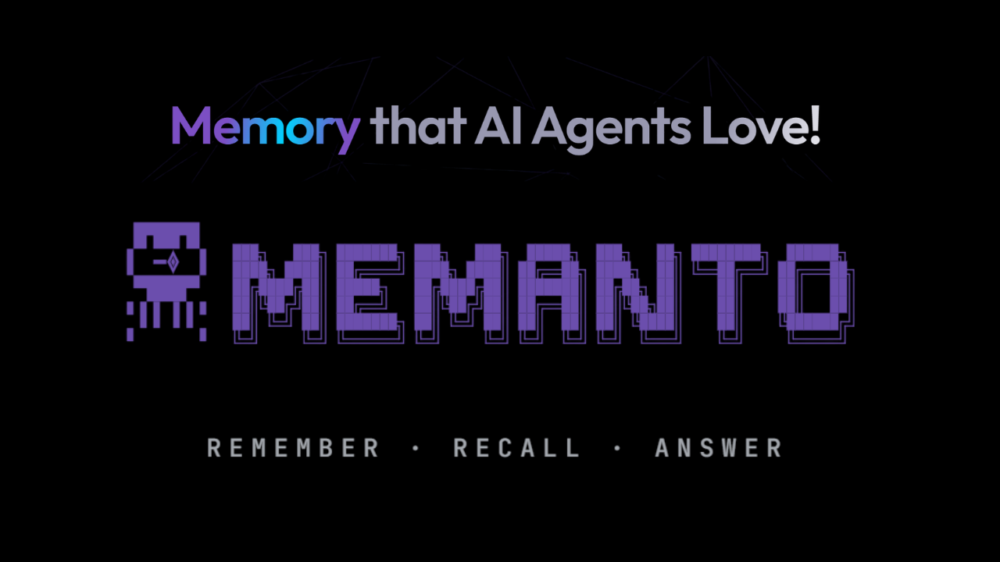

<p align="center">
  <a href="https://www.memanto.ai/">
    
  </a>
</p>

<h3 align="center">Memory that AI agents love.</h3>

<p align="center">
  Memanto is a <strong>memory agent</strong>. It runs beside your other agents, remembers what they learn,<br>
  settles what contradicts, retires what goes stale, and briefs each agent before it acts.
</p>

<p align="center">
  <a href="https://github.com/moorcheh-ai/memanto"></a>
  <a href="https://pepy.tech/projects/memanto"></a>
  <a href="https://arxiv.org/abs/2604.22085"></a>
  <a href="https://pypi.org/project/memanto/"></a>
  <a href="https://mcptoplist.com/server/io.github.moorcheh-ai%2Fmemanto"></a>
  <a href="LICENSE"></a>
</p>

<p align="center">
  <a href="https://memanto.ai"><strong>Website</strong></a> ·
  <a href="https://docs.memanto.ai"><strong>Docs</strong></a> ·
  <a href="https://arxiv.org/abs/2604.22085"><strong>Paper</strong></a> ·
  <a href="https://discord.com/invite/CyxRFQSQ3p"><strong>Discord</strong></a> ·
  <a href="https://memanto.ai"><strong>Memanto Cloud waitlist</strong></a>
</p>

<p align="center">
  <sub><a href="README.md">English</a> · <a href="i18n/README_es.md">Español</a> · <a href="i18n/README_zh-CN.md">简体中文</a> · <a href="i18n/README_ja.md">日本語</a></sub>
</p>

<p align="center">
  <b>89.8%</b> LongMemEval &nbsp;·&nbsp; <b>87.1%</b> LoCoMo &nbsp;·&nbsp; <b>0</b> LLM tokens per write &nbsp;·&nbsp; searchable the <b>instant</b> it's written &nbsp;·&nbsp; <b>38</b> integrations &nbsp;·&nbsp; runs <b>100% local</b>
</p>

<p align="center">
  <a href="https://github.com/moorcheh-ai/memanto/stargazers"></a><br>
  <sub>Like where this is going? A star helps other developers find Memanto, and tells us to keep building it in the open.</sub>
</p>

---

## Give your agent a memory in 60 seconds

```bash
pip install memanto
memanto                        # pick "On-Prem" (Docker, no account) or "Cloud" (free key)
memanto connect claude-code    # or cursor, codex, copilot, gemini-cli, windsurf… 15 tools
```

That's the whole setup. No code changes, no wrapper, no vector database to run. Your agent now remembers across sessions, and so does every other agent you connect.

<table>
  <tr>
    <td width="50%" align="center"><b>Without Memanto</b></td>
    <td width="50%" align="center"><b>With Memanto</b></td>
  </tr>
  <tr>
    <td></td>
    <td></td>
  </tr>
  <tr>
    <td align="center"><sub><i>"What database do I prefer?" → "I don't have any idea."</i></sub></td>
    <td align="center"><sub><i>Same question, new session → "You prefer MongoDB."</i></sub></td>
  </tr>
</table>

---

## Why developers switch to Memanto

### ⚡ Writing memory is free and instant

Most memory systems call an LLM on every write to extract entities or build a graph. You pay for those tokens, and you wait for indexing before anything can be recalled. Memanto calls no LLM on write. `remember` returns, and every agent in your fleet can recall it straight away.

In our [temporal benchmark](examples/benchmarks/temporal-memory-showdown) against Mem0's agentic pipeline, Memanto spent **0 extraction tokens to Mem0's 134,690**, ingested in **0.1 s to Mem0's 48 minutes**, and covered **97.2% of golden answers to Mem0's 69.4%**.

### 🧭 It knows what's true *now*

Your agent said "we're on Postgres" in March and "we moved to MongoDB" last week. A flat vector store returns both, and your agent has to guess. Memanto **supersedes rather than appends**: the current belief comes first, the old one is kept with its date, and contradictions between agents are flagged for you to review. Ask what's true now, or what you believed on any past date. Those are two different questions, and Memanto answers both.

### 🔓 It's yours, all of it

Your memory runs on your machine (Docker + Ollama, no account, nothing leaves). It exports as plain Markdown you can read, diff and commit. It imports from Mem0, Letta, Supermemory, Zep and Hindsight with one command. It's fully open source, with no paid tier holding back the useful half.

---

## A memory agent, not a memory API

> **Every platform will store your agents' memory. None of them will manage it.** Managing it across platforms is against their interest. That is the job of a memory agent.

Claude, Cursor, Bedrock and every vector store will happily keep whatever your agents write. None of them will tell you that two of your agents now believe opposite things about your auth service, that a preference from March is outranking a decision from last week, or that the agent you started this morning is about to redo work another agent finished and reverted.

Memanto does six things on its own judgment. Each one is a shipped feature with a command behind it, not a roadmap item.

| | What Memanto does | Command |
|---|---|---|
| **Extracts** | Pulls durable knowledge (decisions, preferences, facts, failures) out of conversations instead of archiving whole transcripts. | `memanto remember --from-conversation` |
| **Consolidates** | Merges what every agent learns into one shared memory. Duplicates collapse, and repeated observations raise confidence instead of adding rows. | `memanto schedule enable` |
| **Reconciles** | When new knowledge contradicts old, it supersedes and keeps the history. Conflicts between agents are surfaced for review. | `memanto conflicts` |
| **Forgets** | Expiry runs on policies you write. Expired memories are labeled, auditable and restorable. | `memanto policy apply` |
| **Briefs** | Hands a new or returning agent the slice of memory it needs before it acts. | `memanto agent bootstrap` |
| **Moves** | Carries memory across tools and vendors through the Open Knowledge Format, so Claude Code, Cursor and your own stack share one memory instead of five. | `memanto memory export --okf` |

**It works while you sleep.** Run `memanto schedule enable` once. Every night it writes a summary, detects conflicts and sweeps expired memories. You come back to a fleet that knows more than it did yesterday, and you didn't have to sort anything.

---

## Works with everything you already run

**38 integrations.** Most coding agents connect with a single `memanto connect <tool>`.

| | |
|---|---|
| **Coding agents** | Claude Code · Cursor · Codex · GitHub Copilot · VS Code · Gemini CLI · Windsurf · Cline · Continue · Goose · Roo Code · OpenCode · Antigravity · Augment · Kimi Code · Grok Build · Pi |
| **Agent frameworks** | LangChain · LangGraph · LlamaIndex · CrewAI · AG2 (AutoGen) · Google ADK · Amazon Bedrock AgentCore · Pydantic AI · NVIDIA NeMo Agent Toolkit · OpenAI SDK · Vercel AI SDK · Mastra · VoltAgent · Hermes Agent · OpenClaw · Eve · n8n |
| **Protocols & signals** | MCP server · REST API · Open Knowledge Format · Langfuse (errors and failed evals become memories) · Vapi (voice agents) |
| **SDKs** | Python · TypeScript / Node.js · Go |

Want several at once? `memanto connect multi` sets up all your tools in one interactive pass. → [Integration guides](https://docs.memanto.ai)

---

## See it work

```bash
# Monday: backend-agent learns something
memanto remember "Auth migrated to JWT — session cookies deprecated" --type decision

# Friday: review-agent, which never saw that session, already knows
memanto recall "how does auth work"
memanto answer "why did we drop session cookies?"      # grounded answer from memory

# Time travel: what did the fleet believe then, and what has changed since?
memanto recall "deployment policy" --as-of 2026-10-01
memanto recall "deployment policy" --changed-since "last 7 days"

# Housekeeping
memanto conflicts                  # review contradictions found overnight
memanto ui                         # open the local dashboard
```

**From Python**, the client runs in-process with no server to start:

```python
from memanto import Memanto

memanto = Memanto(agent_id="my-agent")          # creates the agent on first use
memanto.remember("Alex prefers oat milk.", type="preference")
memanto.recall("what does Alex drink?")
memanto.answer("Does Alex drink dairy?")
```

Works on macOS, Linux and Windows.

---

## Under the hood

Memanto doesn't wrap someone else's vector database. Recall runs on **[Moorcheh](https://moorcheh.ai)**, our own information-theoretic search engine ([paper](https://arxiv.org/abs/2601.11557)), and it ships in the box as a local Docker container or a free cloud service.

- **No index to build.** There is no HNSW or approximate-nearest-neighbor index to rebuild. Memories are searchable the instant they're written.
- **32× compression.** Embeddings are compressed to binary with Maximally Informative Binarization, which keeps the signal that matters for retrieval.
- **Sub-90 ms, deterministic retrieval.** Results are scored by information-theoretic relevance rather than cosine similarity. The same query returns the same results every time, so you can explain and debug them.
- **One query per question.** There's no graph traversal, no multi-query fan-out and no reranker. The [paper](https://arxiv.org/abs/2604.22085) shows this simpler path beats hybrid graph-and-vector systems on LongMemEval and LoCoMo.
- **13 typed memory categories.** `instruction`, `fact`, `decision`, `goal`, `commitment`, `preference`, `relationship`, `context`, `event`, `learning`, `observation`, `artifact` and `error`, so recall can be filtered by type instead of searching one pile.
- **Every belief is traceable.** Each memory carries a confidence score, source, provenance and timestamp.

<details>
<summary><strong>Architecture diagrams</strong></summary>
<br>
<p align="center">
  
</p>
<p align="center"><b>On-prem</b></p>
<p align="center">
  
</p>
</details>

---

## Proof, not adjectives

**Public benchmarks** ([paper](https://arxiv.org/abs/2604.22085)): **89.8%** on LongMemEval and **87.1%** on LoCoMo, with a single retrieval query and no LLM at ingestion. <!-- TODO (Majid): state reader model, judge model, and subset here — you should be the one in this space whose conditions are legible. --> Datasets and harness are open at [huggingface.co/moorcheh](https://huggingface.co/moorcheh).

**Head-to-head suites** live in this repo. Each one is reproducible, and three use no LLM judge at all:

| Suite | What it stresses | Memanto | Others |
|---|---|---|---|
| [Temporal Memory Showdown](examples/benchmarks/temporal-memory-showdown) | 11 facts that change over 10 sessions | **97.2%** coverage, **0** extraction tokens | Mem0 (agentic): 69.4%, 134,690 tokens |
| [Shifting Persona](examples/benchmarks/memanto-vs-mem0-persona) | 7 reversed preferences over 5 sessions | **85.6%** | Mem0: 54.1% |
| [LoCoMo evidence retrieval](examples/benchmarks/submission_freq1062) | Exact-turn recall@20 (30-query subset) | **83.3%** | Mem0 63.3% · Cognee 23.3% · Zep 20.0% |
| [Executive Shadow](examples/benchmarks/memanto-vs-mem0) | 7 reversed decisions over 6 months (LLM-judged) | **47.5%** | Mem0: 25.8% |
| [Adversarial resilience](examples/benchmarks/adversarial-memory-resilience) | Stale, poisoned and cross-tenant leakage | **94.4%** accuracy | Mem0: 72.9% accuracy, but *lower* stale and poison exposure than Memanto |

**We publish the suites we lose on, too.** Memanto currently lets more stale and injected records into the top results than Mem0 on the adversarial suite, and we're working on it in the open. In the temporal suite, Mem0 with extraction switched off reaches 98.6%. That tells you its LLM extraction pipeline is what costs it accuracy, which is exactly the step Memanto doesn't have.

One caveat we'd rather state plainly: scores from different projects on these benchmarks aren't comparable. Reader model, judge model, judge prompt and retrieval budget each move results by several points, and no two published runs share a configuration. Treat every number in this category as directional, ours included. In the long run a memory agent should be measured on memory quality over time: contradiction rate, staleness, and precision at month six.

---

## Memory that expires on your terms

Every memory stays **active** until a policy you wrote retires it. Expiry is stamped with the rule and the date, it's auditable, and it can be reversed. Expired memories still show up in recall, marked `[EXPIRED]`, until you choose to purge them. An agent with no policy never expires anything.

```bash
memanto policy apply-preset balanced   # conservative / balanced / aggressive
memanto policy apply --dry-run         # exactly what would expire, per rule
memanto memory restore mem-123         # changed your mind? put it back
```

<details>
<summary><strong>Write your own policy</strong></summary>
<br>

Policies live in `~/.memanto/policies/<agent>.yaml`. A per-type retention table handles the broad strokes, and named rules handle everything sharper. The first matching rule wins, so a rule can also *pin* a memory the table would otherwise expire.

```yaml
retention:
  context: 7d
  event: 30d
  preference: never          # durable user truths don't age out
rules:
  - name: pinned
    match: {tags: [pinned]}
    expire_after: never      # an explicit pin beats the table
  - name: low-confidence-guesses
    match: {provenance: [inferred], confidence_below: 0.5}
    expire_after: 14d
purge_expired_after: never   # optional hard delete, off by default
```

Narrow recall with `--active` or `--expired`. Point-in-time recall (`--as-of`) still reconstructs what was true then, including memories that have since expired.

</details>

---

## Security & sovereignty

<!-- ============================================================
     TODO — Majid: fill from your hardening work. Structure is
     right; the specifics are yours. Items marked ⟨…⟩ need input.
     Anything you can't substantiate today, delete rather than soften.
     ============================================================ -->

- **Nothing leaves your machine in on-prem mode.** Docker + Ollama, no account, no outbound calls. The whole loop (extraction, consolidation, reconciliation, briefing) runs locally.
- **Scoped by default.** Each agent gets its own namespace. Your production-ops agent doesn't read your scratch experiments.
- **Auditable.** Every belief can be traced to where it entered the fleet and when. That's the difference between an auditable memory and a black box.
- **Forgetting is a decision, not a side effect.** Expiry is policy-driven and reversible. Deletion is a separate, explicit act.
- **Deploy it your way.** pip, Docker, Compose, systemd or Kubernetes, against cloud or on-prem. `memanto config backend` switches between them, and your memory comes with you.

**No lock-in, because there's nothing to lock.** `memanto memory export --okf` writes the [Open Knowledge Format](https://docs.memanto.ai/integrations/okf): plain Markdown you can read, diff, grep and commit. OKF is an open format that any framework or vendor can implement, our competitors included, on purpose. `memanto migrate` imports from Mem0, Letta, Supermemory, Zep, Hindsight, Langfuse or any OKF bundle.

---

## The dashboard

`memanto ui` opens a local dashboard over your whole memory. It includes a memory explorer, a history timeline, conflict resolution, live connections to your AI tools, expiry policies, migrations, a playground and usage analytics. For a readable digest of what changed across your agents, run `memanto daily-summary`.

<table>
  <tr>
    <td width="50%"><a href="https://www.youtube.com/watch?v=vEtOaoweIG4"></a></td>
    <td width="50%"><a href="https://www.youtube.com/watch?v=5n976CmzohE"></a></td>
  </tr>
  <tr>
    <td align="center"><a href="https://www.youtube.com/watch?v=vEtOaoweIG4"><b>▶ Setup & demo</b></a></td>
    <td align="center"><a href="https://www.youtube.com/watch?v=5n976CmzohE"><b>▶ Local dashboard tour</b></a></td>
  </tr>
</table>

Also worth watching: [**Recall is more than search**](https://youtu.be/zoKP4b_rUhY) (6:20).

---

## What's in the box

Memanto is a mature project, not a weekend experiment.

| | |
|---|---|
| **38** integrations | **3** SDKs, plus a REST API and an MCP server |
| **1,500+** automated tests | **5** reproducible head-to-head benchmark suites |
| **13** typed memory categories | **2** arXiv papers (Memanto + the Moorcheh engine) |
| **6** import sources, plus OKF | **5** deployment targets: pip, Docker, Compose, systemd, Kubernetes |
| A **local dashboard** with 10+ views | **100+** docs pages, README in **4** languages |

---

## ☁️ Memanto Cloud — coming soon

Everything above, hosted. Sign in from your browser, with no Docker, no API keys to juggle, and backups handled for you. **[Get notified at memanto.ai →](https://memanto.ai)**

Until then, the free cloud key gives you 100K operations, and on-prem costs nothing.

---

<details>
<summary><strong>Install options: fully local vs. free cloud</strong></summary>
<br>

**Fully local.** No account, no API key, nothing leaves your machine. Requires Docker.

```bash
pip install memanto
memanto           # choose "On-Prem"; it walks you through Docker + Ollama
```

**Free cloud.** No card, about 60 seconds.

```bash
pip install memanto
memanto           # choose "Cloud" and paste your free API key
```

Get a free key at [console.moorcheh.ai/api-keys](https://console.moorcheh.ai/api-keys) (100K free operations). Switch any time with `memanto config backend`.

**Other languages:**

```bash
npm install @moorcheh-ai/memanto               # TypeScript / Node.js
go get github.com/moorcheh-ai/memanto/sdks/go  # Go
```

</details>

<details>
<summary><strong>SDKs & REST API</strong></summary>
<br>

**Python.** The `memanto` package ships an in-process client with no server to start. [Reference](https://docs.memanto.ai/sdk/python)

**TypeScript / Node.js.** [`@moorcheh-ai/memanto`](sdks/typescript) boots a local Memanto server via `uvx` and exposes `remember` / `recall` / `answer`.

**Go.** [`github.com/moorcheh-ai/memanto/sdks/go`](sdks/go) connects to a running Memanto server or starts one via `uvx`.

**REST API.** Start it with `memanto serve`. The endpoint reference is at [docs.memanto.ai/api](https://docs.memanto.ai/api), and at `http://localhost:8000/docs` while the server is running.

**MCP.** See [`integrations/mcp`](integrations/mcp). It works with any MCP client in a single config line.

</details>

<details>
<summary><strong>Full CLI reference</strong></summary>
<br>

| Capability | Commands | What it does |
|---|---|---|
| System status | `memanto status` | Environment, configuration, server health, active session, registered agents. |
| Local REST API + web UI | `memanto serve`, `memanto ui` | Run the REST API locally and open the browser dashboard. |
| Agent lifecycle | `memanto agent ...` | Create, list and delete agents, activate sessions, run `agent bootstrap`. |
| Memory capture | `memanto remember` | Single memories, batch JSON, or `--from-conversation` to extract from chat logs. |
| Editing & deletion | `memanto edit`, `memanto forget` | Update fields on a memory, or permanently delete a bad one. |
| Expiry | `memanto memory expire`, `memanto memory restore`, `memanto policy ...` | Retire or restore single memories, or manage policy presets, sweeps and purges. |
| File ingestion | `memanto upload` | Bring .pdf, .docx, .xlsx, .json, .txt, .csv or .md into an agent's namespace. |
| Advanced recall | `memanto recall` | Semantic search plus temporal queries (`--as-of`, `--changed-since`), with filters by type, tag and state. |
| Grounded answers | `memanto answer` | Answers generated from retrieved memory. |
| Daily intelligence | `memanto daily-summary`, `memanto conflicts` | Summaries, contradiction detection, interactive resolution. |
| Sessions & automation | `memanto session ...`, `memanto schedule ...` | Inspect sessions, enable the nightly run. |
| Export & sync | `memanto memory export`, `memanto memory sync` | Export structured Markdown (`--okf` for a portable bundle), or inject standing instructions, preferences and goals into your coding agents' instruction files. |
| Import & migration | `memanto migrate` | Import from Mem0, Letta, Supermemory, Zep, Hindsight, Langfuse or an OKF bundle. |
| Configuration | `memanto config show`, `memanto config backend` | Key status, active agent and session, server settings, backend switching. |
| Tool integration | `memanto connect ...` | Claude Code, Codex, Cursor, Windsurf, Antigravity, Gemini CLI, Cline, Continue, OpenCode, Goose, Roo, GitHub Copilot, Augment, Kimi Code, Pi, or `connect multi` for several at once. |

```bash
memanto remember "User prefers concise answers" --type preference
memanto recall "user communication style" --type preference
```

Complete reference: [CLI User Guide](https://docs.memanto.ai/cli)

</details>

---

## Research

**[Memanto: Typed Semantic Memory with Information-Theoretic Retrieval for Long-Horizon Agents](https://arxiv.org/abs/2604.22085)**

The paper shows that a vector-only design with typed memories, conflict resolution and temporal versioning can match or beat hybrid knowledge-graph systems on accuracy, with one retrieval query and zero ingestion cost. It includes a five-stage ablation that isolates where the gains come from.

```bibtex
@misc{abtahi2026memantotypedsemanticmemory,
      title={Memanto: Typed Semantic Memory with Information-Theoretic Retrieval for Long-Horizon Agents},
      author={Seyed Moein Abtahi and Rasa Rahnema and Hetkumar Patel and Neel Patel and Majid Fekri and Tara Khani},
      year={2026},
      eprint={2604.22085},
      archivePrefix={arXiv},
      primaryClass={cs.AI},
      url={https://arxiv.org/abs/2604.22085},
}
```

---

## Community & contributing

<p align="center">
  <a href="https://discord.com/invite/CyxRFQSQ3p"></a>
  <a href="https://www.reddit.com/r/Memanto/"></a>
  <a href="https://x.com/moorcheh_ai"></a>
  <a href="https://www.youtube.com/@moorchehai"></a>
  <a href="https://docs.memanto.ai"></a>
</p>

**Want to open an issue or a PR?** To keep AI spam out, this repo only accepts issues and comments from prior contributors. Sign in once at **[memanto.ai/contributor-onboard](https://memanto.ai/contributor-onboard)** and you'll be added automatically. See [CONTRIBUTING.md](CONTRIBUTING.md).

<p align="center">
  <a href="https://memanto.ai/contributor-onboard"></a>
</p>

<p align="center">
  <a href="https://trendshift.io/repositories/27378"></a>
  <a href="https://deepwiki.com/moorcheh-ai/memanto"></a>
</p>

<p align="center">
  Questions: <a href="mailto:support@moorcheh.ai">support@moorcheh.ai</a> · <a href="https://x.com/moorcheh_ai">@moorcheh_ai</a>
</p>

---

<p align="center">
  <strong>Your agents are about to remember everything that matters, and forget everything that doesn't.</strong><br>
  <sub><code>pip install memanto</code> · Open source · ⭐ <a href="https://github.com/moorcheh-ai/memanto">Star on GitHub</a></sub>
</p>
